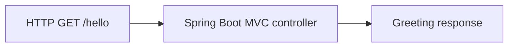

# Spring Boot Demo architecture

Use the upstream Hello World module as a small example of the request path through a Spring Boot application.

## Operational boundaries

The walkthrough covers the inherited demo-helloworld module. Upstream source and attribution are retained. The walkthrough was checked against the source and POM. A Maven build and runtime request were outside this verification.
